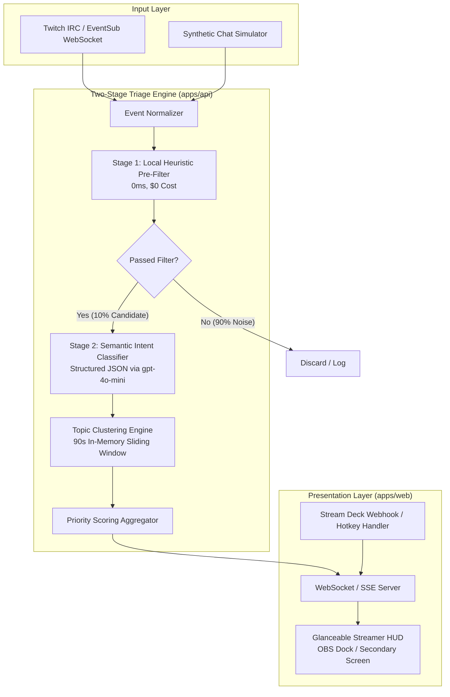
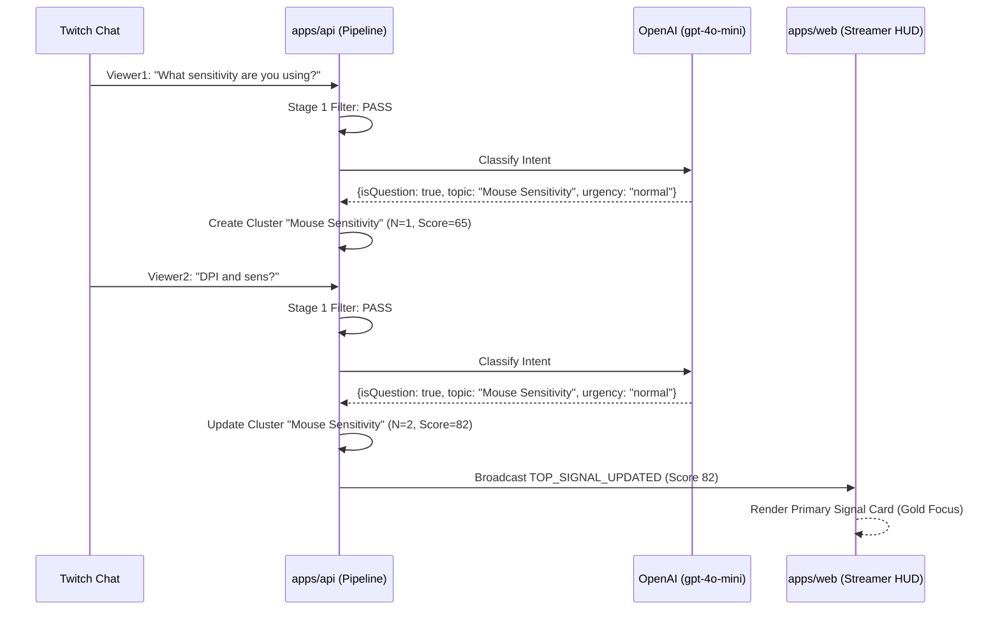

# ChatSignal System Architecture

## 1. Architectural Overview

ChatSignal employs a **Two-Stage Cascading Pipeline** to achieve sub-second latency, zero public distraction, and cost-effective NLP triage on high-velocity chat streams.



---

## 2. Stage 1: Local Heuristic Pre-Filter

### Design Goals:
* Process messages in **< 1ms**.
* Incur **$0 in API token costs**.
* Eliminate **85–92%** of low-entropy chat messages before invoking any LLM.

### Rule Set:
1. **Length Gate**:
   * If `message.length < 5` characters (unless sender is a verified `first_time_chatter`), discard.
2. **Emote-to-Text Ratio**:
   * Calculate Unicode/Twitch emote percentage. If $\text{ratio} > 0.6$, discard.
3. **Single-Token Slang & Banter**:
   * Match against compiled regex of hype words: `^(w|l|pog|poggers|kekw|lul|lol|gg|omg|nice|sheesh|hype|f)$` (case-insensitive).
4. **Duplicate Deduplication (Sliding 30s Window)**:
   * Levenshtein distance or MD5 hash check against the last 100 messages. If repeated $> 3$ times across chat, mark as copypasta and drop priority.
5. **Fast-Pass Rule (Bypass to Stage 2)**:
   * If message contains `first_time_chatter == true` OR begins with `@streamer` OR contains technical alert keywords (`muted`, `black screen`, `lagging`, `audio`), immediately forward to Stage 2.

---

## 3. Stage 2: Semantic Intent Classifier & Clustering

### Structured LLM Invocation
Messages passing Stage 1 are passed in small micro-batches (or sub-second queues) to `gpt-4o-mini` with strict JSON Schema output enforcement:

```typescript
export interface IntentClassificationOutput {
  isQuestion: boolean;
  questionIntent: "gameplay_strategy" | "technical_setup" | "personal_opinion" | "schedule" | "general_banter" | "none";
  confidenceScore: number; // 0.0 - 1.0
  urgency: "urgent" | "normal" | "low";
  canonicalTopic: string;  // e.g. "Mouse Sensitivity Settings", "Champion Build Order"
  suggestedAction: "answer_now" | "answer_later" | "ignore";
}
```

### Sliding-Window Topic Clustering
* An in-memory store maintains active clusters for **90 seconds**.
* When a classified message arrives with canonical topic $T$:
  * If cluster for $T$ exists, append message, increment viewer count $N$, and update last-activity timestamp.
  * If no cluster exists, initialize a new cluster with $N = 1$.
  * Compute priority dynamically using the cluster size multiplier $w_3 \log_2(1 + N)$.



---

## 4. WebSocket Event Contracts

The backend communicates with the Streamer HUD via WebSocket / Server-Sent Events (SSE).

### 1. `SIGNAL_PUBLISHED`
Emitted when a signal or cluster crosses the activation threshold ($P \ge 60$):
```json
{
  "event": "SIGNAL_PUBLISHED",
  "data": {
    "signalId": "sig_9812739182",
    "priorityScore": 88,
    "topic": "Mouse Sensitivity & Settings",
    "representativeMessage": "What DPI and in-game sensitivity are you running?",
    "initiator": {
      "username": "FragKing99",
      "isFirstTimer": true,
      "badge": "first-time"
    },
    "clusterSize": 3,
    "firstSeenAt": "2026-10-27T05:00:00Z",
    "lastSeenAt": "2026-10-27T05:01:10Z"
  }
}
```

### 2. `SIGNAL_RESOLVED`
Emitted when the streamer marks a signal as answered or dismisses it:
```json
{
  "event": "SIGNAL_RESOLVED",
  "data": {
    "signalId": "sig_9812739182",
    "resolution": "answered",
    "clearedByHotkey": true,
    "latencyMs": 24300
  }
}
```

---

## 5. Latency & Resource Budgets

| Component | Target Budget | Fallback Mechanism |
| :--- | :--- | :--- |
| **Twitch Ingestion** | < 50ms | In-memory ring buffer prevents backpressure |
| **Stage 1 Pre-Filter** | < 2ms | Regex compiled once at startup |
| **Stage 2 LLM Classifier** | < 450ms | Timeout after 800ms; default to rule-based fallback score |
| **Cluster Evaluation** | < 5ms | In-memory Map with interval cleanup every 15s |
| **HUD Render Cycle** | < 16ms (60 FPS) | React / Vanilla lightweight DOM nodes without heavy re-renders |
| **Total Pipeline Latency** | **< 600ms** | End-to-end from viewer hitting Enter to streamer seeing HUD card |

---

## 6. Project Layout

```
chatsignal/
├── apps/
│   ├── api/
│   │   ├── src/
│   │   │   ├── connectors/      # Twitch IRC & EventSub handlers
│   │   │   ├── filters/         # Stage 1 Heuristic Regex & Rules
│   │   │   ├── classifier/      # Stage 2 OpenAI Structured LLM caller
│   │   │   ├── clustering/      # In-memory sliding-window topic manager
│   │   │   ├── simulator/       # Synthetic chat generator for dev/demos
│   │   │   └── server.ts        # Fastify / Express WebSocket server
│   │   ├── package.json
│   │   └── tsconfig.json
│   └── web/
│       ├── src/
│       │   ├── components/      # Primary Signal Card, Queue, Controls
│       │   ├── hooks/           # useChatSignal WebSocket hook
│       │   ├── styles/          # Dark-mode glassmorphic HUD styling
│       │   └── index.html       # OBS Dockable entrypoint
│       ├── package.json
│       └── vite.config.ts
├── docs/                        # Complete architecture, product & threat specs
└── tests/                       # Unit tests for scoring & simulator benchmarks
```
