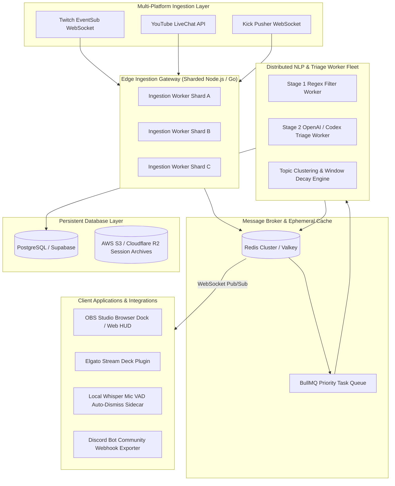
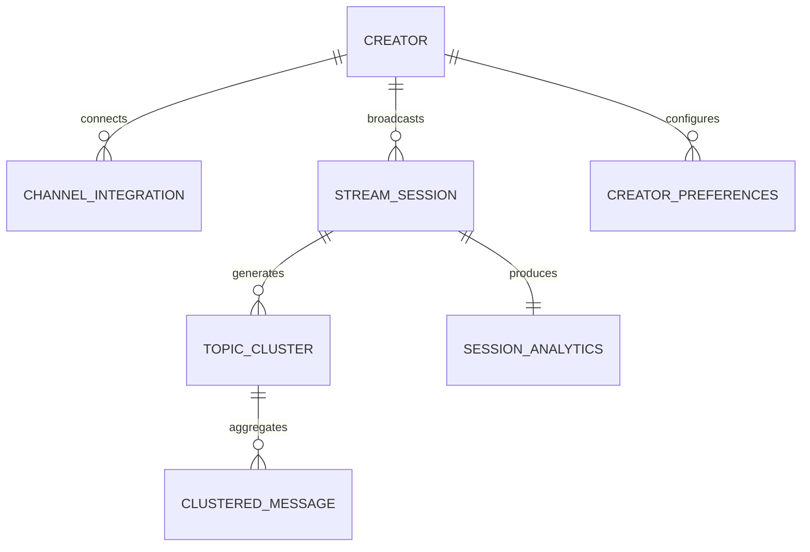
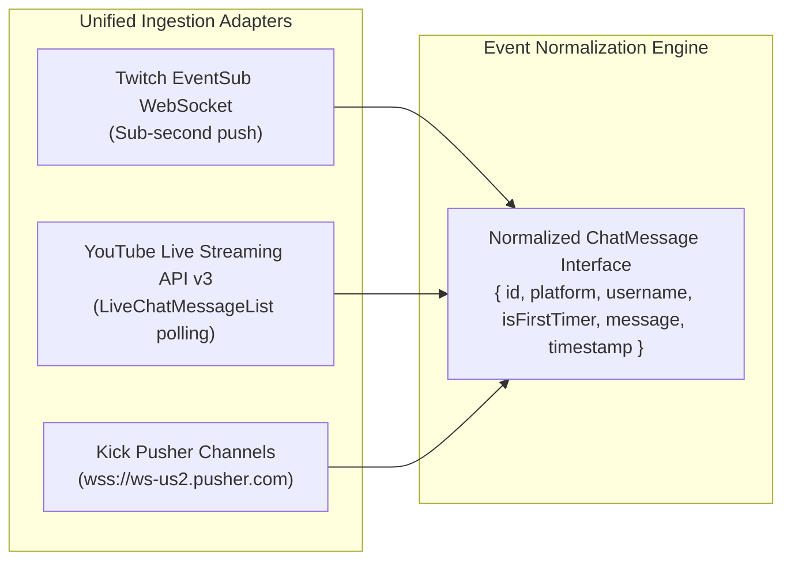
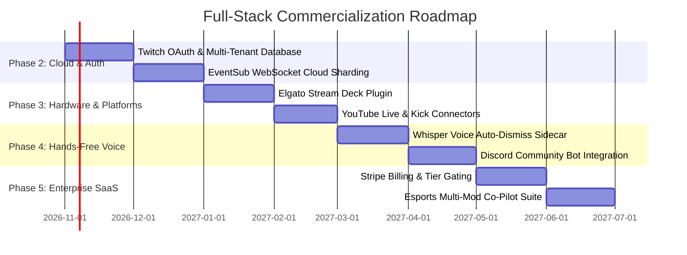
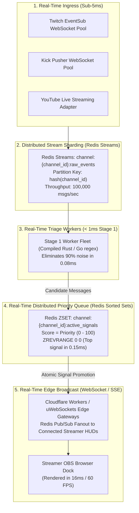

# ChatSignal: Full-Stack SaaS Architecture & Evolution Plan

This document details the complete technical, infrastructural, and product roadmap required to scale **ChatSignal** from a local hackathon MVP into an **enterprise-grade, multi-tenant Full-Stack SaaS platform** for live video game streamers, esports organizations, and broadcast production studios.

---

## 1. Target Full-Stack Cloud Architecture



---

## 2. Database Schema & Data Models (PostgreSQL + Prisma)

To support multi-tenancy, historical stream retention analytics, and customizable creator preferences, the relational schema is designed as follows:



### 2.1 Prisma Schema Specification

```prisma
datasource db {
  provider = "postgresql"
  url      = env("DATABASE_URL")
}

generator client {
  provider = "prisma-client-js"
}

enum Platform {
  TWITCH
  YOUTUBE
  KICK
}

enum UserRole {
  STREAMER
  MODERATOR
  EDITOR
  ADMIN
}

enum SignalStatus {
  ACTIVE
  QUEUED
  ANSWERED
  DISMISSED
  PINNED
  EXPIRED
}

model Creator {
  id              String                @id @default(uuid())
  email           String                @unique
  displayName     String
  avatarUrl       String?
  role            UserRole              @default(STREAMER)
  createdAt       DateTime              @default(now())
  updatedAt       DateTime              @updatedAt

  integrations    ChannelIntegration[]
  sessions        StreamSession[]
  preferences     CreatorPreferences?
  subscriptions   SubscriptionTier?
}

model ChannelIntegration {
  id              String      @id @default(uuid())
  creatorId       String
  platform        Platform    @default(TWITCH)
  channelId       String
  channelName     String
  accessToken     String      // Encrypted with AES-256-GCM
  refreshToken    String      // Encrypted with AES-256-GCM
  tokenExpiresAt  DateTime
  scopes          String[]
  isActive        Boolean     @default(true)
  createdAt       DateTime    @default(now())

  creator         Creator     @relation(fields: [creatorId], references: [id], onDelete: Cascade)

  @@unique([platform, channelId])
}

model CreatorPreferences {
  id                    String   @id @default(uuid())
  creatorId             String   @unique
  weightFirstTimer      Int      @default(30)
  weightIntent          Int      @default(25)
  weightCluster         Int      @default(20)
  weightUrgency         Int      @default(15)
  weightNoisePenalty    Int      @default(50)
  minPriorityThreshold  Int      @default(60)
  soundEnabled          Boolean  @default(true)
  soundVolume           Float    @default(0.7)
  autoDismissTtlSeconds Int      @default(120)
  enableVoiceDetection  Boolean  @default(false)
  bannedKeywords        String[] @default([])

  creator               Creator  @relation(fields: [creatorId], references: [id], onDelete: Cascade)
}

model StreamSession {
  id                String             @id @default(uuid())
  creatorId         String
  title             String?
  startedAt         DateTime           @default(now())
  endedAt           DateTime?
  totalIngested     Int                @default(0)
  totalDropped      Int                @default(0)
  firstTimersSeen   Int                @default(0)
  firstTimersSaved  Int                @default(0)

  creator           Creator            @relation(fields: [creatorId], references: [id], onDelete: Cascade)
  clusters          TopicCluster[]
  analytics         SessionAnalytics?
}

model TopicCluster {
  id                     String             @id @default(uuid())
  sessionId              String
  canonicalTopic         String
  representativeQuestion String
  suggestedTalkingPoint  String?
  category               String
  urgency                String             @default("normal")
  priorityScore          Int
  status                 SignalStatus       @default(ACTIVE)
  hasFirstTimeChatter    Boolean            @default(false)
  viewerCount            Int                @default(1)
  firstSeenAt            DateTime           @default(now())
  lastSeenAt             DateTime           @default(now())
  resolvedAt             DateTime?

  session                StreamSession      @relation(fields: [sessionId], references: [id], onDelete: Cascade)
  messages               ClusteredMessage[]
}

model ClusteredMessage {
  id           String        @id @default(uuid())
  clusterId    String
  username     String
  message      String
  isFirstTimer Boolean       @default(false)
  sentAt       DateTime

  cluster      TopicCluster  @relation(fields: [clusterId], references: [id], onDelete: Cascade)
}

model SessionAnalytics {
  id                      String        @id @default(uuid())
  sessionId               String        @unique
  retentionUpliftPercent  Float
  averageResponseLatencyS Float
  noiseSuppressionRatio   Float
  topTopicsSummary        Json
  exportedToDiscord       Boolean       @default(false)

  session                 StreamSession @relation(fields: [sessionId], references: [id], onDelete: Cascade)
}

model SubscriptionTier {
  id            String    @id @default(uuid())
  creatorId     String    @unique
  planName      String    @default("FREE") // FREE, PRO, AGENCY
  stripeCustomerId String?
  stripeSubId   String?
  currentPeriodEnd DateTime?
  isActive      Boolean   @default(true)

  creator       Creator   @relation(fields: [creatorId], references: [id], onDelete: Cascade)
}
```

---

## 3. Multi-Tenant Authentication & Authorization

### 3.1 Twitch OAuth 2.0 PKCE Flow
1. **Initiate Login**: Creator clicks *"Connect with Twitch"*. Directed to `id.twitch.tv/oauth2/authorize` with state verification and code challenge.
2. **Scopes Requested**:
   * `user:read:email`: Account creation & identity.
   * `chat:read`: Reading IRC chat via EventSub WebSocket.
   * `channel:read:redemptions`: Prioritizing channel point questions.
   * `moderator:read:chatters`: Real-time list of active chatters and first-timers.
3. **Token Management**:
   * Access and Refresh tokens are encrypted with **AES-256-GCM** using AWS KMS / HashiCorp Vault before being saved to PostgreSQL.
   * Automated background refresh workers rotate tokens before expiration.

### 3.2 Role-Based Access Control (RBAC)
* **Streamer (Owner)**: Full permissions to adjust weights, link channels, clear history, and answer signals.
* **Moderator / Co-Pilot**: Authenticated via Twitch OAuth with moderator badge. Can view the secondary HUD, resolve signals on behalf of the creator, and pin questions.
* **Editor**: Read-only access to post-stream session intelligence reports and exported Q&A archives.

---

## 4. Multi-Platform Ingestion Architecture

Full-stack ChatSignal integrates across all major streaming destinations into a single unified triage stream:



* **Twitch**: Official EventSub WebSocket connection (`wss://eventsub.wss.twitch.tv/ws`). Zero IRC lag, structured events for raids, bits, and first-time chatter tags.
* **YouTube Live**: OAuth connection with automatic detection of active live broadcasts. Reads `liveChatMessages` stream with quota-optimized adaptive polling intervals (1.5s during matches, 3.5s during idle).
* **Kick**: Direct secure WebSocket connection to Kick's Pusher cluster (`chatrooms.{chatroom_id}.v2`), standardizing badges and emotes.

---

## 5. Hardware & Native Ecosystem Integrations

```mermaid
flowchart TD
    subgraph CreatorRig ["Creator Desktop Setup"]
        MIC[Streaming Microphone] --> VAD[Local Whisper VAD Sidecar<br/>(Rust / ONNX runtime)]
        SD[Elgato Stream Deck] --> SDK[Stream Deck Plugin<br/>(WebSocket RPC)]
        OBS[OBS Studio] --> DOCK[OBS Browser Dock<br/>(Compact 320px View)]
    end

    subgraph ChatSignalCloud ["ChatSignal Cloud API"]
        API[WebSocket Gateway]
    end

    VAD -- "Auto-Dismiss Trigger (Answer Detected)" --> API
    SD -- "One-Tap Answer / Pin" --> API
    API -- "Active Signal Count" --> SD
    API -- "Real-Time Signal State" --> DOCK
```

### 5.1 Elgato Stream Deck Plugin
* Compiled plugin running on macOS and Windows.
* **Dynamic LCD Key**: Displays the current Top Priority Question score and initiator username.
* **Key Press Actions**:
  * Tap 1: Mark Answered (`Space` equivalent).
  * Tap 2: Pin Signal.
  * Long Press (500ms): Dismiss Signal.
* **Visual Status Icon**: Pulsing gold key when priority score $> 85$; flashing red when an urgent stream alert is triggered.

### 5.2 Local Voice Recognition (Whisper VAD Sidecar)
* **Zero-Click Hands-Free Operation**:
  * A lightweight local binary (written in Rust using `whisper.cpp` / ONNX runtime) listens to the creator's default microphone input.
  * When the streamer speaks aloud: *"Yeah, I'm currently using 800 DPI and 0.4 sensitivity..."*
  * The local acoustic detector matches keywords against the active Top Signal card topic (*"Mouse Sensitivity & DPI"*).
  * Automatically fires an `AUTO_DISMISS_ANSWERED` event to the HUD with zero hand movement required from the streamer.

---

## 6. SaaS Commercialization & Business Model

| Tier | Price | Ideal For | Features |
| :--- | :--- | :--- | :--- |
| **Hobbyist (Free)** | **$0 / mo** | Small creators (< 35 CCV) | 1 Twitch channel, Stage 1 local heuristic filter, 48-hour session history, OBS dock integration. |
| **Creator Pro** | **$12 / mo** | Growing streamers (35–400 CCV) | Multi-platform (Twitch + YouTube + Kick), OpenAI `gpt-4o-mini` triage, AI Copilot talking point suggestions, Stream Deck plugin, Discord Q&A webhook exporter. |
| **Studio / Esports** | **$49 / mo** | Esports orgs, tournaments & agencies | Unlimited channels, shared Moderator Co-Pilot seats, Voice Auto-Dismiss sidecar, SLA priority queue, post-stream cohort retention analytics, dedicated webhook API. |

---

## 7. Execution Milestones: Phase 2 through Phase 5



### Detailed Phase Milestones:
* **Phase 2 (Cloud Migration & Multi-Tenancy)**:
  * Replace in-memory array storage with **PostgreSQL + Prisma** and **Redis Cluster**.
  * Complete Twitch OAuth 2.0 PKCE authentication with encrypted credentials.
  * Deploy horizontally autoscaling Ingestion Workers on Fly.io / AWS ECS.
* **Phase 3 (Hardware Integrations & Multi-Platform)**:
  * Release official **Elgato Stream Deck Marketplace Plugin**.
  * Implement YouTube Live Chat API and Kick Pusher WebSocket adapters into the unified normalizer.
* **Phase 4 (Speech Recognition & Community Expansion)**:
  * Deploy local Rust/Whisper VAD microphone sidecar for automated voice-driven signal resolution.
  * Launch the **ChatSignal Discord Bot** to automatically post unanswered session backlogs into creator Discord servers with interactive reaction voting.
* **Phase 5 (Commercial Monetization & Esports)**:
  * Integrate Stripe billing for Pro and Studio subscription tiers.
  * Build the multi-seat Moderator Co-Pilot dashboard allowing broadcast teams to collaborate on chat triage for tier-1 esports events (*VCT, CS2 Majors, LEC*).

---

## 8. Real-Time Distributed Data Streaming & Low-Latency Synchronization

To guarantee **< 50ms end-to-end latency** from a viewer sending a chat message on Twitch/YouTube/Kick to the streamer seeing the prioritized signal card across 50,000 concurrent channels, ChatSignal uses an **event-driven, distributed real-time streaming pipeline**:



### 8.1 Key Real-Time Data Architecture Components

#### 1. Ingestion Partitioning & Channel Sharding
* Live streams do not share state; every Twitch channel is an independent real-time data silo.
* Channels are mapped onto **Redis Streams** using consistent hashing: `partition_key = crc32(channel_id) % num_shards`.
* A raid of 50,000 viewers in one channel is contained within its dedicated shard and never degrades latency for other creators.

#### 2. Sub-Millisecond Priority Queuing via Redis Sorted Sets (`ZSET`)
* Active clusters are indexed directly in Redis Sorted Sets:
  ```bash
  # Atomic priority score update when multiple viewers ask the same question
  ZADD channel:tarik:signals 92 "sig_champion_build_order"
  
  # Instant sub-0.2ms retrieval of the highest-priority signal for the HUD
  ZREVRANGE channel:tarik:signals 0 0 WITHSCORES
  
  # Atomic expiration of clusters older than 90 seconds
  ZREMRANGEBYSCORE channel:tarik:signals -inf 40
  ```

#### 3. Real-Time Audio Streaming (Microphone VAD via WebRTC)
* Streamers stream 16kHz PCM mono audio in 250ms chunks from their OBS Studio audio source directly over a secure WebRTC DataChannel to the local speech worker.
* Uses lightweight Silero VAD (Voice Activity Detection) to detect speech onset, running zero-latency keyword spotting against the active `representativeQuestion` topic.

#### 4. Real-Time Telemetry & Time-Series Analytics
* Stream metrics are flushed every 5 seconds to **TimescaleDB / Prometheus**:
  * `chatsignal_ingested_messages_total{channel, platform}`
  * `chatsignal_stage1_dropped_ratio{channel}`
  * `chatsignal_llm_inference_latency_ms{model, channel}`
  * `chatsignal_first_time_chatters_rescued_total{channel}`
* Powers live HUD graphs and post-stream creator intelligence reports with sub-second accuracy.

